 

---

## ✦ About Me

I'm **Vidit Mujumdar**, a student who builds **AI-powered, interactive web apps**.

I build web apps that turn something ordinary into something **you can play with**. Snap a photo of a textbook diagram and watch it become a 3D model. Turn a physics drawing into a working experiment. See the real night sky from the moment you were born.

I care about the **visual layer**: 3D, motion and interfaces that feel alive. I also want the AI under the hood to be **checked and safe**, so the app never shows anything it can't back up.

## 🛠️ Tech Stack

### Languages & Web

**Languages:** `TypeScript` · `JavaScript` · `HTML5` · `CSS3`

### Frameworks, 3D & Backend

`Node.js` · `Three.js / WebGL` · `Vite` · `SQLite` · `Canvas 2D`

### AI & Developer Tools

`Google Gemini API` · `Claude Code` · `VS Code` · `Git` · `GitHub` · `Vitest` · `Playwright`

## 📂 Featured Projects

<table>
<tr>
<td width="33%" valign="top" align="center">

 

</td>
<td width="33%" valign="top" align="center">

 

</td>
<td width="33%" valign="top" align="center">

 

</td>
</tr>
</table>

<b>✦ Pop-Up Science: features and technical highlights</b>

 

- **Photo → 3D:** Gemini reads a textbook diagram and *describes* the scene as simple shapes. The app checks every number and builds the model itself with three.js. Nothing from the AI is run as code or inserted as HTML.
- **Explained:** a summary, a step-by-step "Build" mode synced to the 3D view, and tap-a-part highlighting with a camera fly-to. Available in 8 languages, including Hindi, Hinglish, Bengali, Tamil, Telugu and Marathi.
- **Real lessons:** matching YouTube lessons come from the official YouTube Data API search. It never makes up video links.
- **Share & save:** share links, recent pop-ups saved on the device, and snapshots of the 3D view.

<b>✦ Living Notes: features and technical highlights</b>

 

- Photograph a physics diagram, such as a DC resistor circuit, a thin convex lens or projectile motion.
- The AI reads the diagram, then **you review and correct every value** before it becomes a working simulation.
- Change the variables live and ask an AI tutor *why* the result changed.
- Built with TypeScript, Node's built-in `node:sqlite`, Vitest unit tests and Playwright end-to-end tests.

<b>✦ Birth Sky: features and technical highlights</b>

 

- Pick a date, time and city to see every star, the Moon and the planets in their real positions at that moment.
- The astronomy is calculated in the browser, and the sky is drawn on Canvas.
- Export the sky as a poster to keep or gift.

## 🌙 More Projects

| Project | What it does | Built with |
|---|---|---|
| [**Mudra Magic**](https://github.com/ViditMujumdar/mudra-magic) | Form Bharatanatyam mudras in front of your camera: a lotus of light blooms, fire rises, a peacock fan opens. Runs live in the browser and nothing is uploaded. | `MediaPipe` · `Three.js` · `Node.js` |
| [**Holosnap**](https://github.com/ViditMujumdar/holosnap) | AI estimates the depth of any photo, right on your phone, and rebuilds it as a 3D hologram made of light. The photo never leaves your device. | `Transformers.js` · `ONNX Runtime` · `Three.js` |
| [**Campus Clash**](https://github.com/ViditMujumdar/campus-clash) | Swipe through 4 years of college: attendance, CGPA, sleep and money. Every week you survive scores points for your college on a live leaderboard. | `JavaScript` · `Node.js` |

✦ Built under a purple sky · Thanks for stopping by ✦

